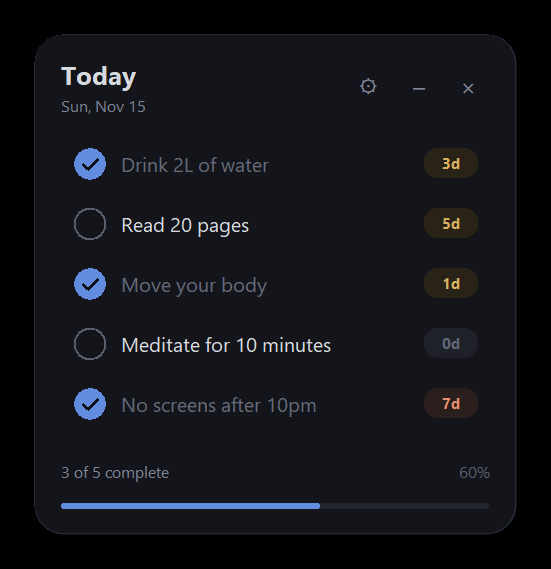
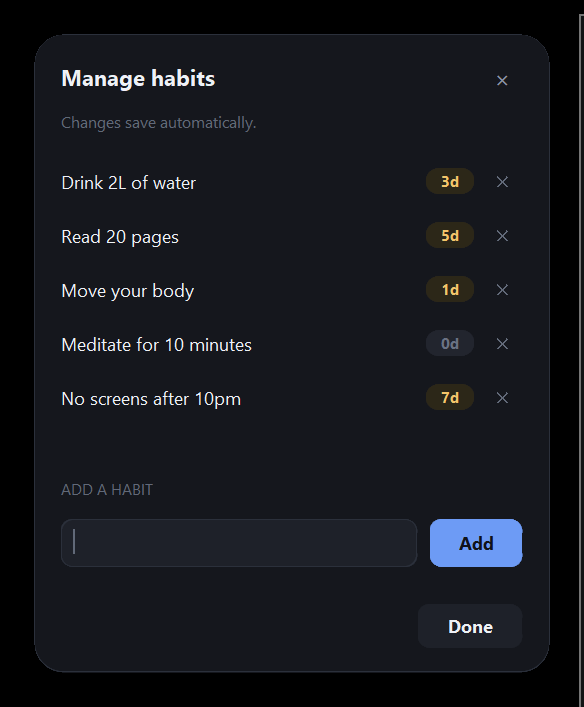

# Habit Tracker

A lightweight, frameless daily habit tracker that floats on your Windows desktop.
It stays out of the way in the system tray, keeps your data in two small JSON
files, and gets out of bed with you in the morning.



## Features

- Frameless, dark rounded card at 90% opacity, hidden from the taskbar and Alt+Tab.
- Minimize button hides the card to the tray; close button quits the app.
- Drag anywhere on the background to move it; the position is saved to
  `config.json` and restored on launch.
- Daily checklist with circular checkboxes, current-streak badges, and a progress bar.
- Checkmarks reset at midnight, including after sleep/wake or a clock change
  (the app checks the date every 20 seconds).
- Add and remove habits from a small frameless settings modal (gear icon or tray).
- Tray menu: show/hide, manage habits, **always on top**, **start with Windows**, quit.
- Builds into a standalone `.exe` with a Desktop shortcut via `build.ps1`.
- Two-step delete protection and automatic quarantine of an unreadable
  `habits.json`.
- Single-instance guard; atomic JSON writes; UTF-8 (BOM tolerated).

## Requirements

- Windows 10 or 11
- Python 3.10+
- `customtkinter`, `pystray`, `Pillow`

## Install

From this folder, with the Python environment you want to use:

```powershell
conda activate base
python -m pip install -r requirements.txt
```

## Run

```powershell
pythonw main.py
```

`pythonw` runs it without a console window. Use `python main.py` if you want to
see logs live; they are also written to `habit_tracker.log`.

On first launch the card appears near the top-right of the primary monitor with a
short empty-state message. Click the gear (or use the tray) to add a habit.

## Standalone Windows program

`build.ps1` wraps PyInstaller and can install the result for the current user:

```powershell
python -m pip install pyinstaller
.\build.ps1              # builds dist\Habit Tracker.exe
.\build.ps1 -Install     # builds, installs, and creates a Desktop shortcut
```

`-Install` copies the executable to
`%LOCALAPPDATA%\Programs\Habit Tracker\Habit Tracker.exe` and creates
`Habit Tracker.lnk` on your Desktop, using the app icon embedded in the exe.
The installed program is self-contained and does not need Python installed.

## Using it

- **Toggle a habit:** click its row or the check circle.
- **Move the widget:** drag any non-interactive part of the card.
- **Minimize:** click the `–` button, left-click the tray icon, or use the tray
  menu. The card hides to the system tray; the menu label changes between
  *Hide widget* and *Show widget*.
- **Manage habits:** click the gear, or tray menu → *Manage habits…*. The small
  modal has two-step delete buttons and an add field.
- **Always on top:** tray menu → *Always on top*. The setting is saved.
- **Start with Windows:** tray menu → *Start with Windows*. This creates or
  removes `Habit Tracker.lnk` in your per-user `shell:startup` folder, pointing at
  the executable (or `pythonw.exe` with this `main.py` when running from source).
- **Quit:** click the `×` button or tray menu → *Quit*.



A streak stays alive during the current day: if a habit is completed today, the
badge counts back from today; otherwise it counts back from yesterday. A fully
missed day resets the streak to zero.

## Data

When running from source, both files live next to `main.py`. The installed
program keeps them in its install folder
(`%LOCALAPPDATA%\Programs\Habit Tracker`) when that folder is writable, and falls
back to `%LOCALAPPDATA%\HabitTracker`. Set `HABIT_TRACKER_HOME` to use a different
folder.

| File | Contents |
| --- | --- |
| `config.json` | `x`, `y`, `always_on_top` |
| `habits.json` | schema version and habits (`id`, `name`, `created`, `history`) |

`history` is a sorted list of local ISO dates (`YYYY-MM-DD`). Example:

```json
{
  "version": 1,
  "habits": [
    {
      "id": "2f1d...",
      "name": "Read 20 pages",
      "created": "2026-11-01",
      "history": ["2026-11-14", "2026-11-15"]
    }
  ]
}
```

If `habits.json` cannot be parsed, it is moved to
`habits.corrupt-YYYYMMDD-HHMMSS.json` instead of being overwritten.

`config.json` and `habits.json` are git-ignored; they are personal data, not source.

## Tests

```powershell
python -m unittest discover -s tests -t . -v
```

The tests cover streaks, date validation, atomic persistence, corruption
quarantine, config validation, and BOM tolerance. They do not need a display.

## Project layout

```
main.py                  startup, logging, single-instance guard
app/config.py            config.json model
app/habits.py            habit records, streaks, habits.json
app/storage.py           atomic JSON read/write and quarantine
app/startup.py           shell:startup shortcut management
app/win.py               Windows API helpers (DPI, taskbar, rounded region)
app/icon.py              tray icon artwork
app/tray.py              pystray icon and menu
app/controller.py        Tk/tray thread bridge and application lifecycle
app/ui/widget.py         the floating card
app/ui/habit_row.py      one habit row
app/ui/settings.py       the manage-habits modal
app/ui/controls.py       circle checkbox, drag behavior, text truncation
app/ui/theme.py          colors, dimensions, fonts
assets/icon.ico          startup/window icon
build.ps1                PyInstaller build + optional install/Desktop shortcut
```
